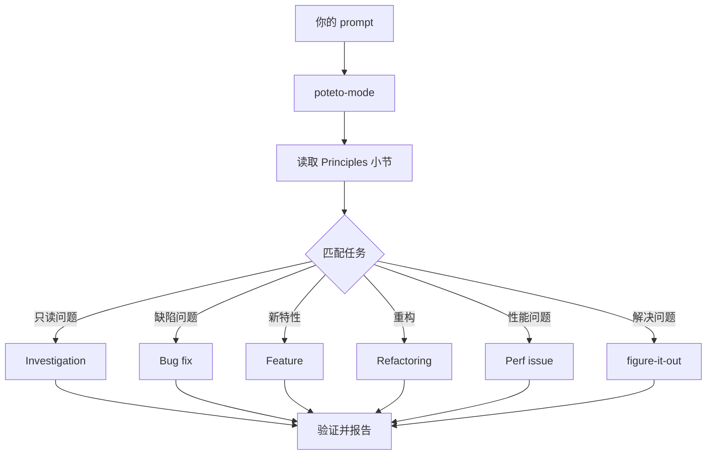

# 通过 `/poteto-mode` 引导工作

`/poteto-mode` 是前门。你给它一个目标，它会匹配二十三个剧本之一，把该剧本的步骤复制进待办列表，并在步骤需要时调用其他技能。本页教你什么是好的 prompt，以及你实际需要写的有多么少。


## 你的 prompt 会经历什么



图中展示的是常见路线。此外还有用于爬坡优化某个指标、诊断运行时症状与已采集 trace、原型、视觉一致性、编写与评估技能、自主运行、打开 PR、守护 PR 或 PR 栈直到可合并、交付已验证的栈、自动运行 PR 队列或栈、编排项目级计划、接续会话、安全暂停、多阶段计划以及 worktree 清理的剧本。[剧本目录](../../skills/poteto-mode/playbooks/) 有完整列表。

## 说目标，不说仪式

你不写规格说明。你说哪里不对或你想要什么，再加上任何你已经知道、能节省 agent 时间的信息：

```text
/poteto-mode users get two notifications after a retry. repro first, then fix and verify.
```

这是一条 Bug fix prompt。"repro first" 是真实的约束，不是客套，剧本会遵守它。看着待办列表被 Bug fix 的步骤填满。被跳过的步骤会保留可见，并带有 `skip: <reason>`。

## 提示词里该写什么

一条有用的 prompt 最多包含五件事，每件一句话就够：

- **目标。** 说明哪里不对，或你想要什么。
- **完成检查。** 它必须能够通过或失败。"把它做得更好"和"在这上面干一小时"都不是检查。
- **你想看到的证明。** 要求真实的命令输出、流程视频、存储的值，或前后对比数字。
- **你已经知道的信息。** 一个症状、一个复现步骤、一行日志或一个链接，能省去 agent 的一次搜索。
- **真实约束。** "repro first"、"先别改任何代码"、"零行为变化"和"继续之前让我审阅"都会改变 agent 的行为。

下面这条 prompt 包含全部五要素：

```text
/poteto-mode the csv export drops its last row since yesterday's deploy. failing job id is 4812. repro first, then fix. done means the 60k-row fixture exports every row. show me the row counts before and after.
```

有两件事值得省略：

- **怎么做。** 说清楚要实现什么，给 agent 留出找到比你更好的路径的空间。列一堆技能也是同样道理，下面的陷阱会讲。
- **你一开始的原因猜想。** 说出猜测会把搜索限制在你指向的地方。先让 agent 重述问题，再分享你的直觉。

对于嘈杂的报告，例如很长的 thread 或含混的 bug，把重述作为第一步：

```text
/poteto-mode read this thread. restate the underlying issue in your own words, in plain english. don't change any code yet.
```

误读会在重述中暴露出来，那时还没有任何代码。在那里纠正它，代价是一条消息，而不是一次错误的修复。如果只需要重述、不要剧本，运行 [`/in-your-own-words`](../../skills/in-your-own-words/SKILL.md)。它会重述 agent 认为你的目标是什么、你想解决什么问题。

当你不确定 prompt 是否瞄准正确时，发送前先对它运行 [`/sharpen`](../../skills/sharpen/SKILL.md)：

```text
/sharpen write a migration guide for the v2 config format.
```

agent 会说出顶尖专业人士会做而你没要求的事、他们会从什么最原始的材料开始、他们会用什么方法和工具，以及除了你或 agent 之外还有什么能证明结果正确。然后它重写你的 prompt，精确地要求这些内容——更深但不更大——并保留你的选择空间。它不执行任务。读一读改写稿，然后发送它，例如交给 `/poteto-mode`。

## 后续消息可以很短

当对话已经携带上下文时，prompt 会缩到几乎为零。下面这些都够用：

```text
/poteto-mode do it
```

```text
continue
```

```text
keep going until done
```

短之所以有效，是因为剧本持有结构，而 Custom Mode 让 `/poteto-mode` 在每一轮都留在上下文中。[设置 pstack](./01-setup.md#运行你的第一个任务)展示了如何启动一个。你的话承载意图，技能承载严谨性。

## 用 "new task" 切换任务

长聊天会累积上一个任务的上下文。当你换话题时，要明确说出来：

```text
/poteto-mode new task. figure out why the cache entry survives logout. don't change any code yet.
```

"new task" 告诉 `/poteto-mode` 重新匹配，而不是继续上一个剧本。"don't change any code yet" 把这次固定为 Investigation。没有这两个短语，一个正处于 Feature 中途的模式往往会把你的问题当作下一个功能步骤。

## 给并行工作独立的机器

如果你在一台电脑上对同一个仓库运行多个 agent，它们会争抢工作树、端口和构建输出。最干净的隔离是 [cloud subagent](https://cursor.com/docs/subagents#cloud-subagents)。每个 subagent 得到自己的 VM 和分支，因此可以安装依赖、运行你的应用并录制结果视频，而不触碰你的机器。在任务前输入 `/in-cloud`，或让父聊天把工作交给 cloud subagent。

当工作必须留在本地时，提前要求一个 worktree：

```text
/poteto-mode new task. branch off <base> in a fresh worktree, then port the parser change there.
```

每个任务在自己的分支和 worktree 中，意味着没有 agent 会踩坏另一个的文件。Worktree 消耗磁盘和机器资源，所以一台笔记本同时只能跑少量几个。[Opening a PR 剧本](../../skills/poteto-mode/playbooks/opening-a-pr.md)在代码改动时本来就在 worktree 中工作，所以通常只有特定 base 或位置重要时才需要说这句。

Worktree 会累积。磁盘紧张时，问：

```text
/poteto-mode what's eating my disk? prune the worktrees that are safe to prune.
```

[Worktree cleanup 剧本](../../skills/poteto-mode/playbooks/worktree-cleanup.md)按合并状态、未提交工作和仍在触碰它的聊天对每个 worktree 分类。它只删除证据允许删除的内容，并对任何仍有未提交工作的项暂停等待你决定。

## 让它继续跑

当你离开时，说清完成意味着什么，然后走开：

```text
/poteto-mode im stepping away. keep going until the migration check reports zero old callers. log your decisions.
```

你之后要审阅的工作会走 [`/figure-it-out`](../../skills/figure-it-out/SKILL.md)，它会设计运行的各个阶段，并维护一份 [`/show-me-your-work`](../../skills/show-me-your-work/SKILL.md) 决策日志。[在你睡觉时继续工作](./07-overnight.md)涵盖了完整的过夜契约。

**陷阱：** 不要在 prompt 里罗列技能（"先用 /how，再用 /architect，再用 /arena……"）。剧本已经排好了它们的顺序，手写的顺序通常会重排或丢掉剧本本会保留的步骤。只有当你想要覆盖某个特定选择时，才点名技能。

完整的路由规则请阅读 [`poteto-mode`](../../skills/poteto-mode/SKILL.md) 本身。

下一步：[理解代码](./03-understand.md)。
