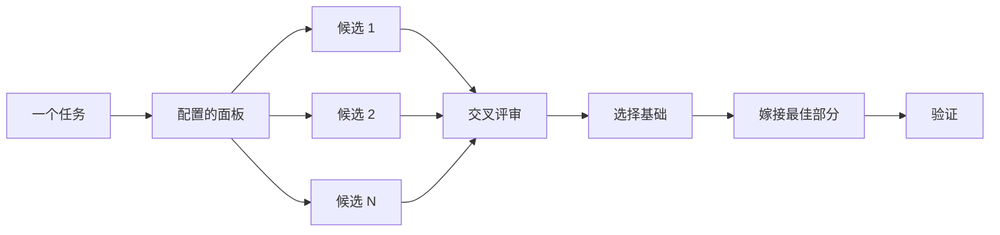

# 写代码之前先设计

对困难设计只尝试一次，就会锁定模型想到的第一个形态。`/architect` 在实现之前敲定类型和边界。`/arena` 对同一份简报运行多次尝试并合并最好的部分。`/interrogate` 让其他模型尝试攻破结果。当任务需要的是覆盖而不是设计综合时，`/swarm` 分发分片或运行竞赛并汇总结果。

两个最常见的设计错误是：接受 agent 的第一个设计，以及打磨一个没有任何代码检验过的计划。本页修正这两点。你通过代码做计划。原型回答悬而未决的问题，README 或教程设定目标，书面计划放在最后。


## 用 `/architect` 敲定形态

```text
/architect design the import pipeline before writing any code. i care most about how callers use it.
```

[`/architect`](../../skills/architect/SKILL.md) 先建立根基，对设计涉及的代码运行 `/how`，在移动所有权或分层时运行 `/why`。然后运行 `/arena` 产出相互竞争的设计草图，每份都先写调用方的用法，再写类型、签名和模块地图。

默认情况下，它从综合后的设计直接进入实现。如果你想先看设计，说明它：

```text
/architect with checkpoint. stop and show me before implementing.
```

代码开始后，设计不再是神圣不可动的。如果实现显示同样的变通做法出现在无关的地方，或者类型只有借助 `any` 或强制转换才能编译，`/architect` 会把这视为设计错误的证据。它会丢弃草图重新开始，而不是打补丁绕过。

## 用 `/arena` 展开多次尝试

```text
/arena take my prompt to the arena verbatim. i want to compare their proposals with yours.
```

[`/arena`](../../skills/arena/SKILL.md) 是底层的通用工具。N 个 subagent 并行尝试同一份设计或代码简报，各自写入自己的 worktree 或目录。来自不同模型族的只读评审者按评分标准为每个候选打分。当没有其他模型族可运行时，协调者跳过评审，自行选择基础方案。协调者从头到尾阅读每个候选，选择一个基础，把落选者的最佳想法嫁接进来，然后验证结果。



面板来自你的 [`/setup-pstack`](../../skills/setup-pstack/SKILL.md) 配置，你可以按任务调整。决策重要时多要几个候选，不重要时少要几个：

```text
/arena this, 5 candidates. the cache key format is expensive to change later.
```

## 用 `/swarm` 覆盖分片和竞赛

```text
/swarm check every package under packages/ against its check.sh. one worker per package. one report.
```

[`/swarm`](../../skills/swarm/SKILL.md) 把 N 个 worker 分发到相互独立的分片、覆盖矩阵、gauntlet 赛道、探索分区或声明的竞赛分支。每个 worker 有自己的范围和检查，然后报告 `PASS`、`ISSUES` 或 `BLOCKED`。父级等待所有 worker，返回一份紧凑报告，包含任何缺口或掉队。

当并行能换取覆盖，或让独立检查竞赛时使用它。`/arena` 给每个 worker 同一份设计或代码简报，然后选一个基础并嫁接最佳部分。`/swarm` 覆盖分片，或运行一场预先声明选择规则的竞赛。它不使用基础选择和嫁接的仪式。

## 用 `/interrogate` 攻破它

```text
/interrogate the whole branch, but skeptically. no nitpicks unless it's an actual bug or regression.
```

[`/interrogate`](../../skills/interrogate/SKILL.md) 把改动及其意图交给配置模型上的对抗者，每个对抗者都通过针对真实代码的运行来尝试攻破它。对抗者会发现不同的失败。只有重跑其命令能显示一个破坏意图的失败时，发现才成立。报告列出每个已验证的发现及发现它的对抗者，然后列出每个对抗者丢弃了什么以及为什么，什么都不应用。

也要读 Dropped 列表。你可以推翻裁决。

## 用原型代替辩论

绝不要接受第一个设计。要几个，从你能看见的证据中选择：

```text
/poteto-mode prototype a few options for the new dropdown menu. take screenshots or videos for me to compare.
```

[Prototype 剧本](../../skills/poteto-mode/playbooks/prototype.md)在临时目录中构建一次性草图，把变体放在一个切换器后面，逐个驱动，并采集截图或耗时。它同样适用于行为和算法，不只是 UI。原型是用代码做计划。它们让 agent 通过运行东西来回答自己的悬而未决的问题，而不是问你，也为一个你没想到的选项留出空间。

同样的想法可以放大到真实设计。把 `/architect` 与原型配对，并保留一个审阅关口：

```text
/poteto-mode we need rate limiting for external webhooks. /architect it first, and answer open questions with prototypes. let me review before proceeding.
```

不要把对抗者浪费在抽象计划上。`/interrogate` 会丢弃任何运行无法证明的发现，所以没有代码支撑的计划让它们没有什么可攻破的。让原型敲定问题，然后审阅真正构建出来的东西。

## 共享代码先写 README

对于其他代码会使用的包或 API，从用户会读的文档开始：

```text
/poteto-mode write a tutorial for how i would use the new config package first. then /teach me why it beats the current one.
```

先写教程会强制采用调用方视角。你向假想的用户描述 API，再倒推实现。文档还会成为一个具体目标，agent 可以据此检查自己的工作。当文档本身很重要时，点名 [`/technical-writing`](../../skills/technical-writing/SKILL.md)，这样教程会保持为教程，而不会同时漂移成参考和解释。

## 设计确定后再做计划

pstack 故意没有计划技能。当你确实想要书面计划时，等设计确定再要：

```text
/poteto-mode turn this design into a plan. small verifiable PRs, each with its own verification steps.
```

[Multi-phase plan 剧本](../../skills/poteto-mode/playbooks/multi-phase-plan.md)用原型敲定任何剩余的悬而未决问题，然后为每个 PR 写一个小节，每节以证明改动有效结束。仅有通过的测试套件不算这种证明。计划就是交付物。剧本不实现它，并指出接下来应由哪个执行剧本运行它。

对于迁移，在 prompt 中说明标准：

```text
/poteto-mode plan the migration of our ui library to the new styling system. small verifiable PRs, each with visual regression checks. the result must match the original exactly, bugs included.
```

"bugs included" 防止迁移顺手修复问题——那会让新旧输出无法比较。对于跨越很多天的项目，你可以把计划提交到仓库一段时间，让其他 agent 看到进行中的工作。工作落地后删除它。

## 一个任务值得多少设计工作？

你可能在想是不是每个改动都需要这些。不是。大多数改动都不需要。一个大致的阶梯：

- 一个已完成但你不确定的小改动，只需要 `/interrogate`。
- 跨越函数边界或移动所有权的改动值得 `/architect`，它会连带 `/arena`。
- 独立尝试会有帮助的单独决策，例如命名、格式或算法，直接用 `/arena`。
- 覆盖矩阵、并行检查集合或带声明分支的竞赛，用 `/swarm`。
- 一个通过运行东西就能回答的悬而未决问题，例如布局、时序或思路，用原型而不是辩论。
- 一个有争议且难以逆转的设计，用 `/architect`，然后在交付前用 `/interrogate`。
- 跨越多个 PR 的工作，在设计确定后写一份计划。

`/poteto-mode` 已经应用了这个阶梯。跨边界的工作会自动触发 `/architect`，所以直接使用这些技能，主要是在你想要比默认更多或更少审查时。

下一步：[构建并清理改动](./05-build-and-clean.md)。
