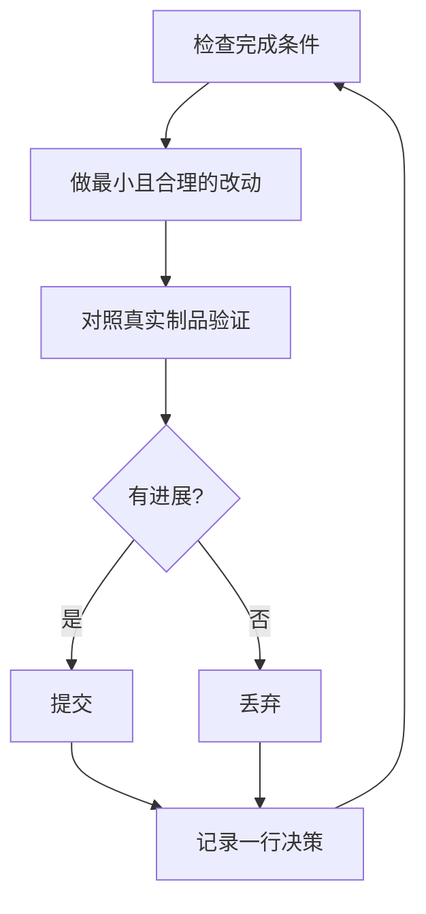

# 在你睡觉时继续工作

这是前面所有内容的回报。一个你信任它能验证自己工作的 agent，是一个你可以留下独自面对困难任务的 agent。让这件事安全的不是希望，而是一个可检查的完成条件、一个隔离的 worktree 或 cloud agent，以及一份你早晨可以审计的决策日志。


## 开循环之前先赢得信任

你不信任的循环只会更快地产出未经检查的工作，而且每迭代一次混乱就会累积。在留下一个循环运行之前，检查它是否已经赢得信任：

- 你亲手做过一次该任务，或看过 agent 做，所以你知道好的结果长什么样。
- agent 拥有你自己会用的工具和信号：验证技能、profiler、日志。
- 每个阶段都证明自己的工作，并在工作不达标时能停下整条线。
- 你读过几份 transcript，并把反复出现的失败转化成了工具、技能或检查。

只有在以上四条全部成立之后，才让循环自主运行。在那之前，运行它时你要看着。

## 过夜契约

好的交接包含目标、完成条件、权限和一个逃生口。它不需要很长：

```text
/poteto-mode im going to bed. migrate every caller to the new parser in a fresh worktree off <base>.
done means zero old callers, all parser fixtures pass, old api deleted.
keep a decision log. don't ask me before committing.
/loop until done. if you're truly stuck after a few hours, stop and write up why.
```

逐行看看每一句带来什么：

- "im going to bed" 是会话级覆盖。agent 停止提问，继续推进。
- "done means..." 把目标变成每次迭代都能运行的检查。
- "fresh worktree off `<base>`" 让这次运行不会与你在打开的其它东西冲突。
- "don't ask me before committing" 预先回答了 agent 否则会阻塞等待的权限。
- `/loop` 是 Cursor 内置的唤醒机制，不是 pstack 技能。[Autonomous run 剧本](../../skills/poteto-mode/playbooks/autonomous-run.md)用它按事件或心跳重新检查完成条件。
- 逃生口让它能在真正的死路处停下并写下原因，这胜过八小时的创造性目标重解释。

因为你会在离开后审阅这些工作，`/poteto-mode` 会让它走 [`/figure-it-out`](../../skills/figure-it-out/SKILL.md)，后者在任何代码之前设计运行的各个阶段，并接入决策日志。

要有意停止一次运行，告诉 agent 暂停，或告诉它你即将下线或重启 Cursor。[Pause safely 剧本](../../skills/poteto-mode/playbooks/pause-safely.md)会完成或退出当前步骤，提交一个进行中的检查点，并写下恢复说明。新聊天通过 Session pickup 剧本从该说明接续工作。说"keep going"绝不会触发暂停。

## 循环整夜都在做什么



一次改动、一次检查、一行日志，每次迭代都是如此。没有帮助的改动会被丢弃，而不是留下来搭便车。平台期意味着转向，而不是停止，完成条件绝不会悄悄放宽来宣布胜利。

## 早晨审计

[`/show-me-your-work`](../../skills/show-me-your-work/SKILL.md) 是让运行可审阅的关键。每一行记录时间、阶段、决策、原因、证据指针和结果，写在 `decisions.tsv`（或当多个运行共享一个目录时的 `.audit/<task-slug>.tsv`）中。它默认留在本地。当工作足够宏大、审阅者需要这条轨迹才能信任结果时，提交它。

你回来时，用审阅的形式要求查看运行：

```text
/show-me-your-work catch me up on what you did last night
```

在技能交回摘要之前，它会派生一个不同模型族的审阅者来阅读轨迹和 transcript，回复末尾有一个 Attention 小节，列出值得你细看的内容。先读那个小节，然后读它指向的日志行。你是在审计决策，而不是重读整个夜晚。

如果只想要快速状态而不是审计，在运行工作过的那个聊天里运行 [`/ketchup`](../../skills/ketchup/SKILL.md)。它只读，用平实的语言告诉你自你最后一条消息以来发生了什么变化，附带工作产生的截图和小图。然后它列出每一个等你处理的事项，例如合并、批准或选项之间的选择，并给出它的建议、证据和风险，让你仅凭回复就能决定。

## 当夜晚承载的是队列而非单个任务

上面的契约把一个任务驱动到一个完成条件。有些夜晚承载更多：一队相互独立的改动，或整个项目计划。三个剧本把同样的信任放大。

[Autopilot-full](../../skills/poteto-mode/playbooks/autopilot-full.md) 把一队独立 PR 运行到合并。每个 PR 有一个 owner agent，从头到尾负责它直至合并，没有任何 owner 凭自己的裁决合并。一群全新的验证者检查 owner 的代码就绪 head。之后的 rebase 或小修复只需一个全新验证者，只有新行为或大型新 diff 才再次调用完整的 swarm。只有对将要合并的那个 patch 给出干净裁决，才授权合并：

```text
/poteto-mode full autopilot on this queue. each item is independent. i want them merged by morning.
```

[Autopilot-stack](../../skills/poteto-mode/playbooks/autopilot-stack.md) 是不含合并的 Autopilot-full。你醒来看到已验证的 PR，每个都有裁决，由你亲自审阅和落地。PR 只堆叠在它所基于的 PR 之上。当你希望在任何东西合并之前亲自过目时，选择它而不是 Autopilot-full：

```text
/poteto-mode autopilot these five changes, but don't merge. i'll land them in the morning.
```

[Orchestrate](../../skills/poteto-mode/playbooks/orchestrate.md) 用于一个比任何单个 agent 活得都久的计划：多天、大量堆叠 PR、在一个常驻协调聊天下的一群 subagent。协调者决定哪个 agent 做哪块工作，检查每个 agent 产出什么，自己从不写代码。如果一个 agent 可以在一次会话中完成工作，剧本本身会把你路由回上面的过夜契约：

```text
/poteto-mode orchestrate the store migration. own it until every package is converted and merged. i'll check in twice a day.
```

## 并行运行多个项目

一个 [Cursor Project](https://cursor.com/blog/projects) 给一个协调者 agent 一个持久 thread。协调者不写代码。它指挥 subagent，subagent 默认在云端运行，所以你的笔记本合上时工作仍在继续。这正是 Orchestrate 剧本所期望的形态。给协调者的 prompt 以 `/poteto-mode` 开头，它派生的 subagent 就会遵循剧本。

几个习惯有帮助：

- 让每一块工作拥有自己的 Project，例如一个功能、一次迁移、一次性能冲刺或一次技术债清理。多个项目可以并排运行。
- 把相关的聊天拖进 Project，包括已完成的。它们会成为其中每个 agent 的上下文。
- 让每个 PR 在合并前先过一个验证 swarm，并让 Autopilot-stack 或 Autopilot-full 承载队列。
- 向协调者要一个由数据支撑的计划，让它在问你之前先用原型回答悬而未决的问题。

一条 prompt 可以承载整个 Project，从研究到执行：

```text
/poteto-mode refactor this repo so its architecture is more agent friendly. use /correct and /architect on past commits and review comments to find the mistakes agents make most here. use /recall for context from past chats. answer open questions with prototypes instead of asking me. come back with a plan backed by real data. once i approve it, run it with autopilot-stack or autopilot-full, and ask me which.
```

## 让循环自己启动

上面的每个循环仍在等你启动。定时或事件驱动的自动化会去掉这一步。软件维护可以拆成很适合这种做法的一些阶段：分类报告、复现、修复、验证修复。两条规则让这样的流水线可信：

- 每个阶段都能停下整条线。triage 可以判定报告是预期行为，repro 可以无法复现，fixer 可以判定改动风险过高。这些结果都有用，因为它们阻止坏工作到达下一阶段——在那里回退的代价更高。
- 每个阶段都交出证据。repro 附上损坏状态的截图和视频，fix 附上前后对比证明。人类随后可以在读一行代码之前检查 agent 修的是不是正确的东西。

pstack 把它作为用于 Slack issue report 的休眠[自动化包](../../automations/benny/README.md)发布。一个自动化分类每份报告。另一个复现已确认的 bug，并可能准备一个小型草稿修复。让一个 agent 指向其 [`FOR_AGENTS.md`](../../automations/benny/FOR_AGENTS.md) 并说明目标仓库即可设置它。

**陷阱：** 时长不是完成条件。"在这上面干 4 小时"没有给 agent 任何可检查的东西，你醒来时得到的会是四小时的动作而不是结果。给 `/loop` 一个能够通过或失败的谓词。

下一步：[用原则名称引导](./08-principles.md)。
